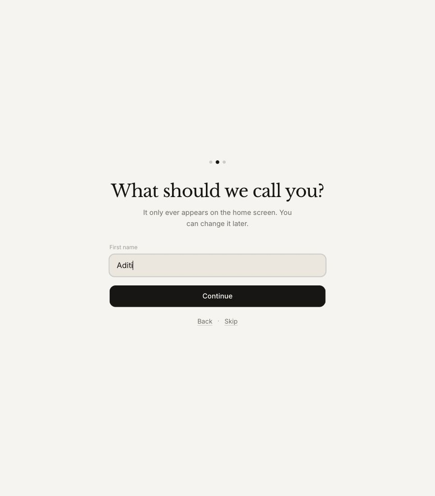
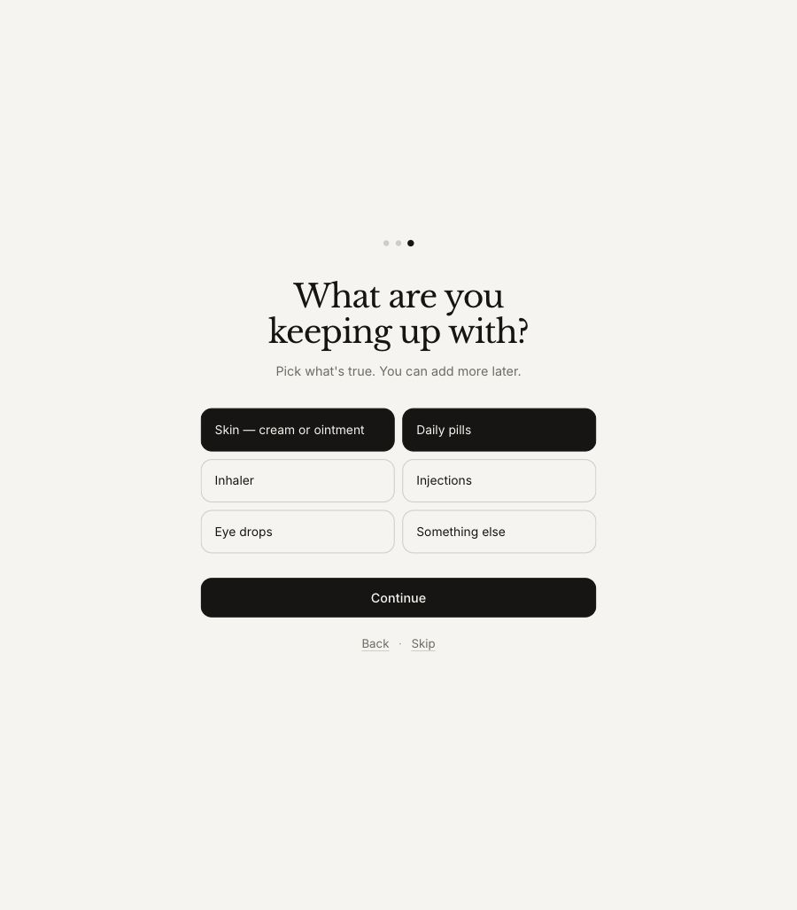
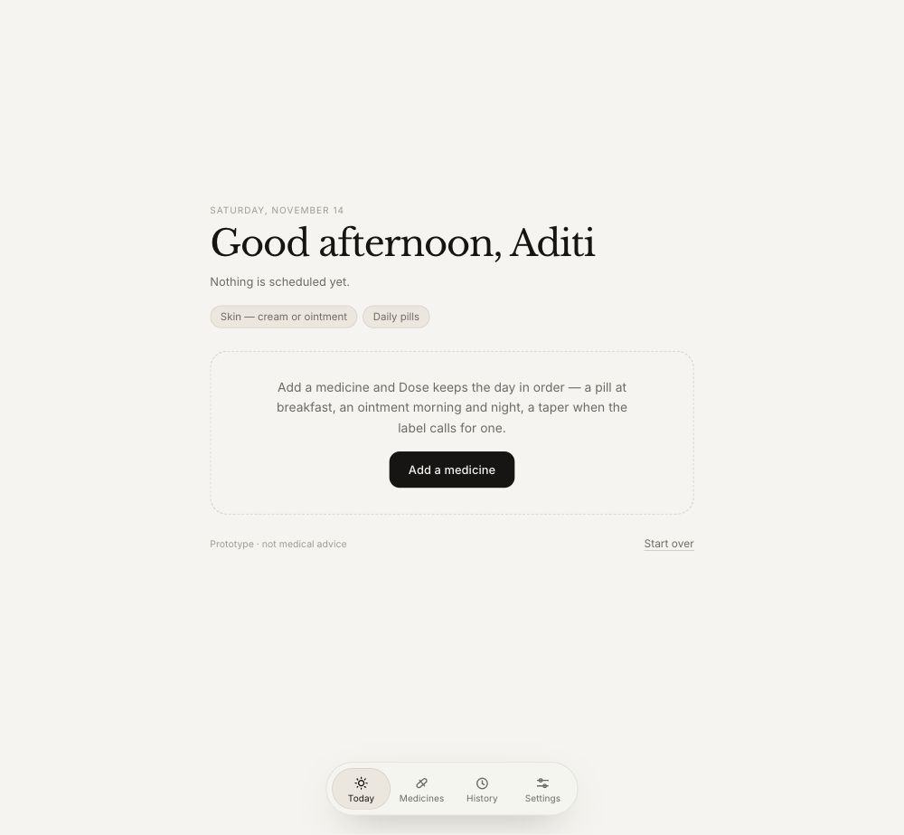

# Dose

A local-first desktop app for one person's ongoing treatment: what they take, and when it's due.

Built for the **AI + Health** track of the Veritas AI International High School Hackathon 2026.

> This project is a prototype and is not medical advice.


## Who it's for

Two people, both real. **Aditi, 34**, with eczema on her hands: a steroid ointment twice a day for
three weeks, then once a day for a week, then stop. She isn't confused about the medicine, she's
confused about *which week she is in* — and she stops early because the rash looks better on day
nine. **Her father, 71**: four tablets at three different times, and no patience for a phone app on
a kitchen counter at 7am.

The tool is designed around how they'd actually reach for it — at the counter, holding the box, five
seconds of patience.

## What's built

| Screen | State |
|---|---|
| Welcome | done — dot-matrix scene, one way in |
| Your name | done |
| What you're keeping up with | done — regimen *shapes*, not diagnoses |
| Home | done — greeting, today's doses, empty state |
| Dock | done — Today, Medicines, History, Settings (last three are placeholders) |
| Scan a medicine | done — camera, frame, capture. It does not read the label yet |
| Label → schedule | **not built** — this is the next piece and the part the judging turns on |
| Scheduler, notifications | not built |

Onboarding is three pages with Typecode's two-dot-turned-three page flow; the choices persist to
`localStorage` under `dose.profile`, so a reload lands on Home. **Start over** in the footer wipes it.

| | |
|---|---|
|  |  |
|  |  |

## Run it

```bash
cd app
npm install
npm run dev          # http://localhost:5181
```

Vite + React + TypeScript, no build step needed to look at it. The Tauri shell is not wired up yet;
it's the same React app and wrapping it is a `tauri init` away.

## Design

The visual language is lifted from Typecode — the same serif, the same quiet geometry, the same page
flow. `REVIEW.md` has the numbers (420px column, 24px card radius, 6px dots at a 7px gap, 31px Libre
Baskerville at −0.015em) and an honest account of where this app is weak.

Two deliberate departures from that reference: **paper is the default theme** (this is used at 7am,
not at a desk — `data-theme="night"` switches it), and **body type is 14.5px** rather than 13.5px.

## The AI, and why it isn't here yet

A reminder shell is not a machine-learning project, and the brief says a normal app built with AI
coding tools "doesn't count on its own". The judged piece is **label → schedule extraction** —
photograph the box, get frequency, dose, duration, route and any taper, quoted against the label
text — measured field-by-field against a regex/catalogue baseline on 40–60 real medicines from our
own kitchens. `REVIEW.md` §6 sets out the test set, the baseline, the measure and the five failures
we expect before running it.

Everything stays on the machine. No account, no analytics, no health data leaves the device.

## Also in this repo

`plume/` is an earlier, retired climate prototype: a world map of PM2.5 with the wind field over it.
It has its own README. Kept for the record; not part of this submission.

## Credits

- **Libre Baskerville** and **Inter**, both SIL Open Font License, bundled in `app/public/fonts`.
- The dot-matrix renderer is adapted from Typecode's `PixelMatrix`.
- Everything else is hand-written for this project. No icon library, no UI kit, no model API yet.
