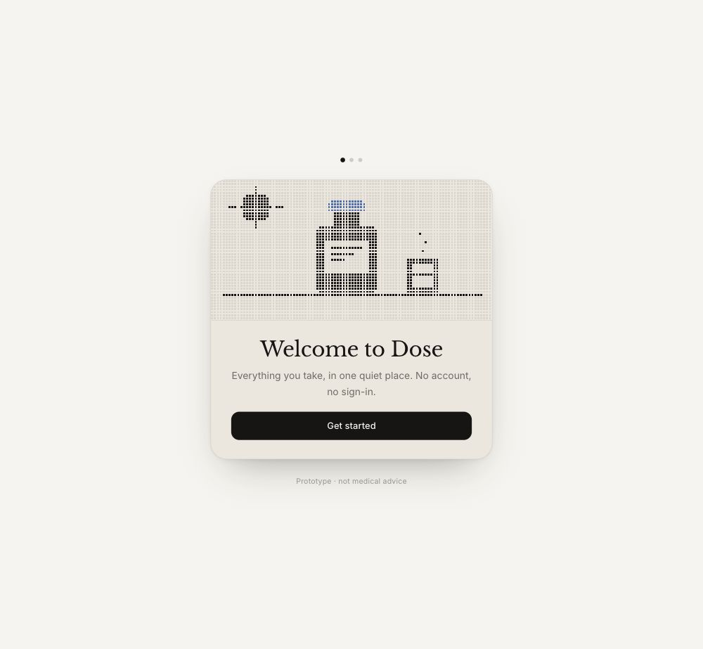
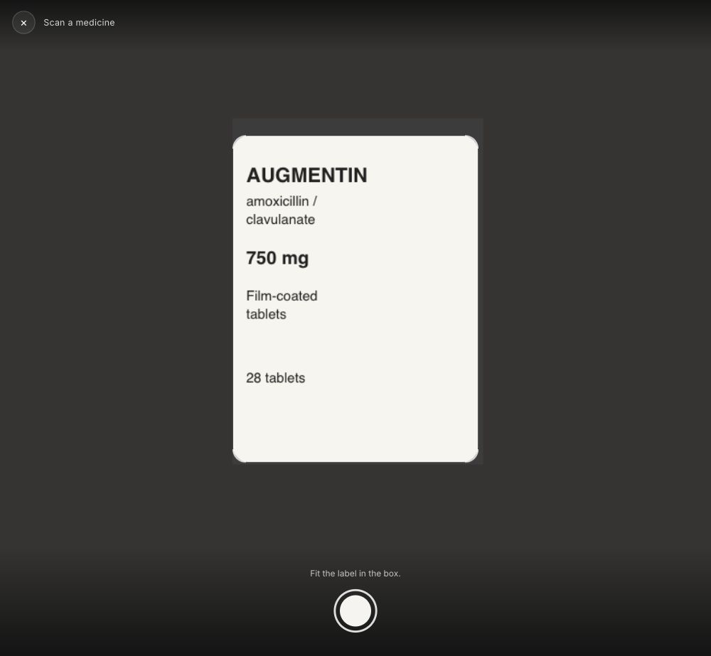
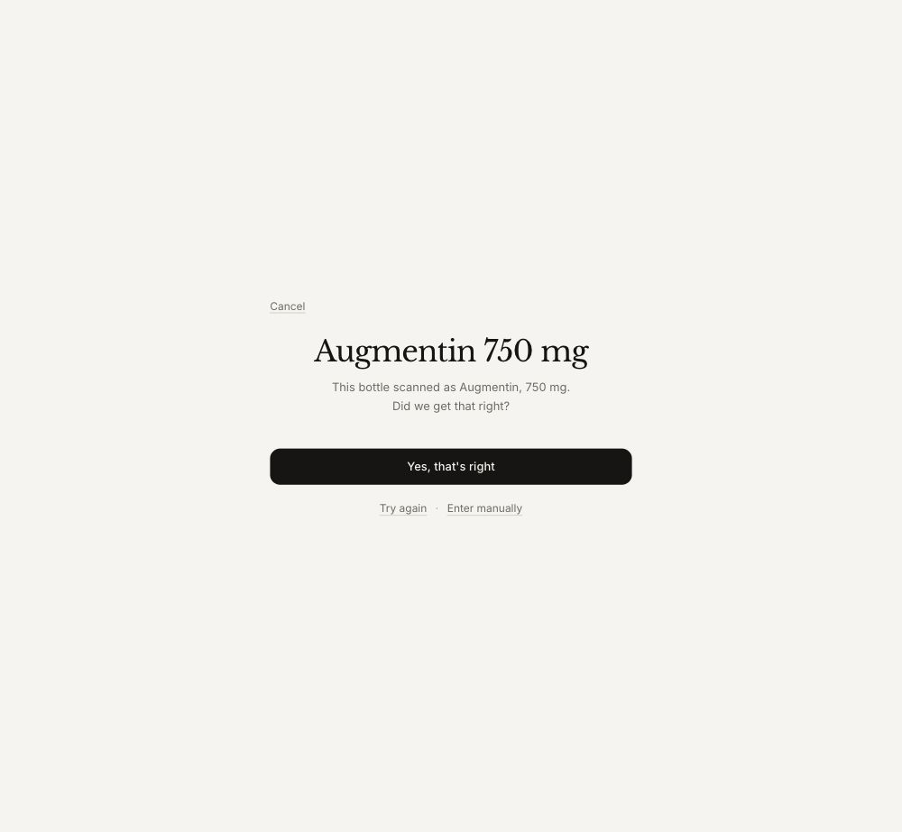
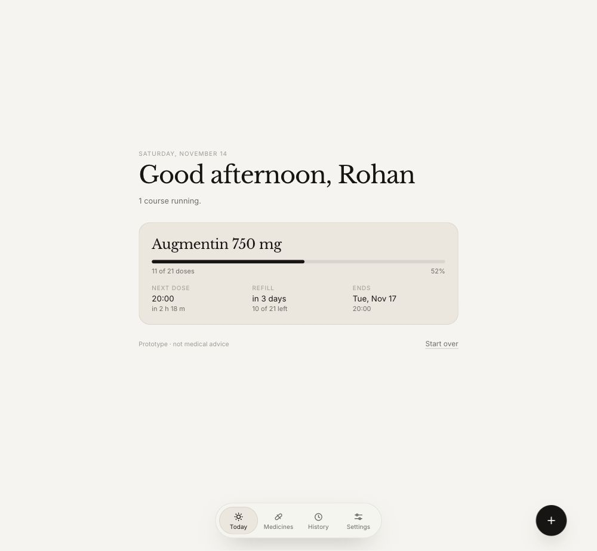
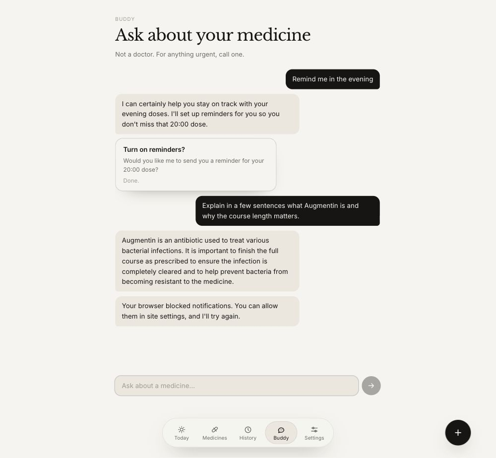

# Dose

A local-first desktop app for one person's ongoing treatment: what they take, and when it's due.

Built for the **AI + Health** track of the Veritas AI International High School Hackathon 2026.

> This project is a prototype and is not medical advice.



## Who it's for

Two people, both real. **Aditi, 34**, with eczema on her hands: a steroid ointment twice a day for
three weeks, then once a day for a week, then stop. She isn't confused about the medicine, she's
confused about *which week she is in* — and she stops early because the rash looks better on day
nine. **Her father, 71**: four tablets at three different times, and no patience for a phone app on
a kitchen counter at 7am.

The tool is designed around how they'd actually reach for it — at the counter, holding the box, five
seconds of patience.

## What's built

| Screen | State |
|---|---|
| Welcome | done — dot-matrix scene, one way in |
| Your name | done |
| What you're keeping up with | done — regimen *shapes*, not diagnoses |
| Home | done — greeting, today's doses, empty state |
| Dock | done — Today, Medicines, History, Buddy, Settings (the middle two are still placeholders) |
| Scan a medicine | done — live camera, a 360×480 box, and the shutter crops to exactly that box |
| Confirm the read | done — the name, strength and kind, read for real; *"did we get that right?"* → yes / try again / enter manually |
| Received + AM/PM | done — the day the prescription was handed over, morning or evening |
| Times + course length | done — 1–3 doses a day at set times, 3–30 days |
| Plan | done — a progress bar of doses behind you, then next dose, refill and the day the course ends |
| Buddy | done — streams its replies, is grounded in the medicines on file, and can offer an action card ("turn on reminders?") instead of describing one |
| Label → schedule | the reader is built (`lab/`), wired through a loopback bridge; the schedule is still asked for, not inferred |
| Scheduler, notifications | not built |

Onboarding is three pages with Typecode's two-dot-turned-three page flow; the choices persist to
`localStorage` under `dose.profile`, so a reload lands on Home. **Start over** in the footer wipes it.

| | |
|---|---|
|  |  |
|  |  |
|  |  |
|  | |

The reader picks its answer from a closed list of twelve kinds — tablet, capsule, inhaler, injection, drops, cream, ointment, gel, liquid, patch, spray, other — so the app never has to render a class it has no rule for. `app/src/kinds.ts` is the single list; the parser and the Gemini schema both constrain to it.

Adding a medicine is four steps after the shutter: the read is confirmed before anything is
saved (yes / try again / enter manually), then when the prescription was handed over and whether
it's a morning or evening course, then how many doses a day, at what times, for how many days. The
plan then answers the three questions that matter — when the next dose is, when the supply runs
out, and when the course ends.

## Run it

```bash
cd app
npm install
npm run dev          # http://localhost:5181
```

Vite + React + TypeScript, no build step needed to look at it. The Tauri shell is not wired up yet;
it's the same React app and wrapping it is a `tauri init` away.

## Design

The visual language is lifted from Typecode — the same serif, the same quiet geometry, the same page
flow. `REVIEW.md` has the numbers (420px column, 24px card radius, 6px dots at a 7px gap, 31px Libre
Baskerville at −0.015em) and an honest account of where this app is weak.

Two deliberate departures from that reference: **paper is the default theme** (this is used at 7am,
not at a desk — `data-theme="night"` switches it), and **body type is 14.5px** rather than 13.5px.

## The AI, and why it isn't here yet

A reminder shell is not a machine-learning project, and the brief says a normal app built with AI
coding tools "doesn't count on its own". The judged piece is **label → schedule extraction** —
photograph the box, get what it is and how it is taken — measured field by field against a regex
baseline on real medicines.

It runs in two lanes, and the order matters:

1. **On this machine.** Apple's Vision framework, wrapped in a 90-line Swift CLI
   (`lab/labelocr.swift`), reads a label in about 60 ms. Free, offline, no key.
2. **Gemini, only when the local read is unsure.** If Vision returns no name, or a name it does not
   trust, the photograph is escalated to `gemini-3.1-flash-lite`, which handles glare, angles and
   handwriting better — and is the only part of this app that sends anything off the device.

The fusion rule is in `lab/read.py`: local first, escalate below 0.7 name confidence, merge the
fields, and tell the caller which lane it used. On our own photographs the rule earns its place — a
sharp canister reads locally with no network at all, and a frame with a blurred second label goes
out and comes back correct.

**The photo leaves the machine on that second path.** The app makes no claim about staying local:
the welcome screen says what the product is for, and the disclosure lives here rather than in a
promise the code cannot keep.

Everything else stays on the machine: no account, no analytics, no health data stored anywhere but
the app's own directory.

## Also in this repo

`plume/` is an earlier, retired climate prototype: a world map of PM2.5 with the wind field over it.
It has its own README. Kept for the record; not part of this submission.

## Credits

- **Libre Baskerville** and **Inter**, both SIL Open Font License, bundled in `app/public/fonts`.
- The dot-matrix renderer is adapted from Typecode's `PixelMatrix`.
- Everything else is hand-written for this project. No icon library, no UI kit, no model API yet.
